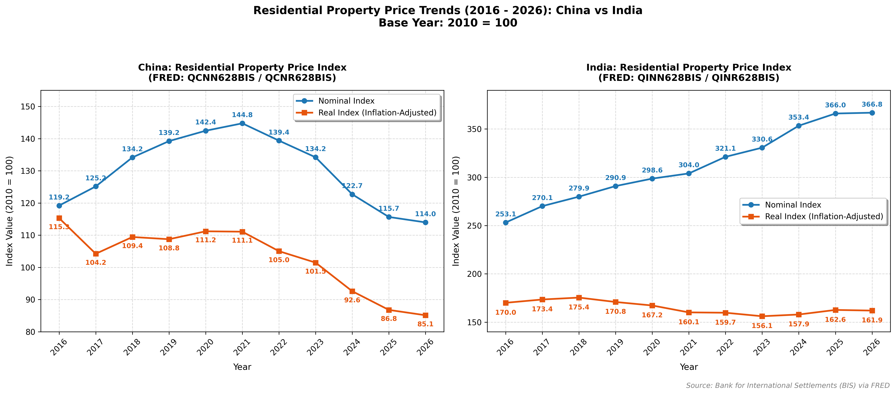

<p align="center">
  
</p>

<p align="center">
  <a href="https://github.com/ishandutta2007/Awesome-Awesome-Awesome"></a>
  <a href="https://discord.gg/jc4xtF58Ve"></a>
  <a href="https://github.com/ishandutta2007/RealEstate-Price-Trends/stargazers"></a>
  <a href="https://github.com/ishandutta2007/RealEstate-Price-Trends/network/members"></a>
  <a href="https://github.com/ishandutta2007/RealEstate-Price-Trends/issues"></a>
  <a href="https://github.com/ishandutta2007/RealEstate-Price-Trends/blob/main/LICENSE"></a>
  <a href="https://www.python.org/"></a>
  <a href="https://github.com/ishandutta2007"></a>
</p>

# 🏘️ Residential Property Price Trends (2016 – 2026): China vs. India 📈

A comprehensive comparative analysis of residential property price indices across **China** 🇨🇳 and **India** 🇮🇳 using authoritative quarterly economic data from the **Bank for International Settlements (BIS)** via the **Federal Reserve Bank of St. Louis (FRED)** database.

---

## 📊 Overview & Comparative Plot 🖼️



---

## 🔍 Key Insights & Dynamics 💡

| Metric / Country | **China** (🇨🇳) | **India** (🇮🇳) |
| :--- | :--- | :--- |
| 🏷️ **Nominal Trend** | Rose steadily to peak at **144.75** (2021) before dropping to **113.98** (2026). | Surged strongly and consistently from **253.13** (2016) to **366.84** (2026). |
| 📉 **Real Trend (Inflation-Adjusted)** | Hovered around 104–115 until 2021; fell below 2010 baseline to **85.13** in 2026. | Remained largely resilient in the 156–175 range, finishing at **161.94** in 2026. |
| 🏗️ **Market Driver** | Regulatory de-leveraging ("Three Red Lines"), developer liquidity contractions, and demographic headwinds. | Strong domestic urban housing demand, economic expansion, and post-pandemic premium residential uptake. |

---

## 🗃️ Data Source Details 📚

All series are indexed with **2010 = 100** and published by the **Bank for International Settlements (BIS)** 🏛️:

| Country | Metric | FRED Series ID | Frequency |
| :--- | :--- | :--- | :--- |
| 🇨🇳 **China** | Residential Property Prices (Nominal) | [`QCNN628BIS`](https://fred.stlouisfed.org/series/QCNN628BIS) | 📅 Quarterly |
| 🇨🇳 **China** | Real Residential Property Prices (Inflation-Adjusted) | [`QCNR628BIS`](https://fred.stlouisfed.org/series/QCNR628BIS) | 📅 Quarterly |
| 🇮🇳 **India** | Residential Property Prices (Nominal) | [`QINN628BIS`](https://fred.stlouisfed.org/series/QINN628BIS) | 📅 Quarterly |
| 🇮🇳 **India** | Real Residential Property Prices (Inflation-Adjusted) | [`QINR628BIS`](https://fred.stlouisfed.org/series/QINR628BIS) | 📅 Quarterly |

---

## 🚀 How to Run the Script 💻

### 🛠️ Prerequisites
Make sure you have Python 3 and `matplotlib` installed:

```bash
pip install matplotlib
```

### ⚡ Execution
Run the visualization script:

```bash
python real_estate_trends.py
```

The script will render the side-by-side comparative chart and export an updated high-resolution figure at [`real_estate_trends_china_india.png`](real_estate_trends_china_india.png) 🎨.

---

## 📈 Star History

[](https://star-history.dera.page/#ishandutta2007/RealEstate-Price-Trends&type=date&legend=top-left)

---

## 💖 Support & Sponsoring ☕

Thank you for checking out this project! If you found this analysis helpful, insightful, or interesting, please consider:
- ⭐ **Starring** this repository to show your appreciation
- 🍴 **Forking** the repo to contribute or extend the research
- 📢 **Sharing** with fellow researchers, analysts, and developers

If you'd like to support my open-source work and buy me a coffee, you can sponsor me on GitHub:

<p align="left">
  <a href="https://github.com/sponsors/ishandutta2007">
    
  </a>
  <a href="https://github.com/sponsors/ishandutta2007">
    
  </a>
</p>

Your generous support is greatly appreciated! 🙌
